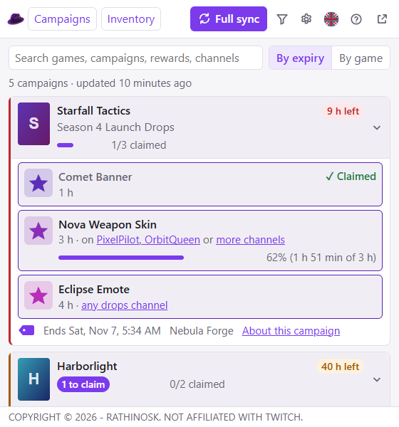
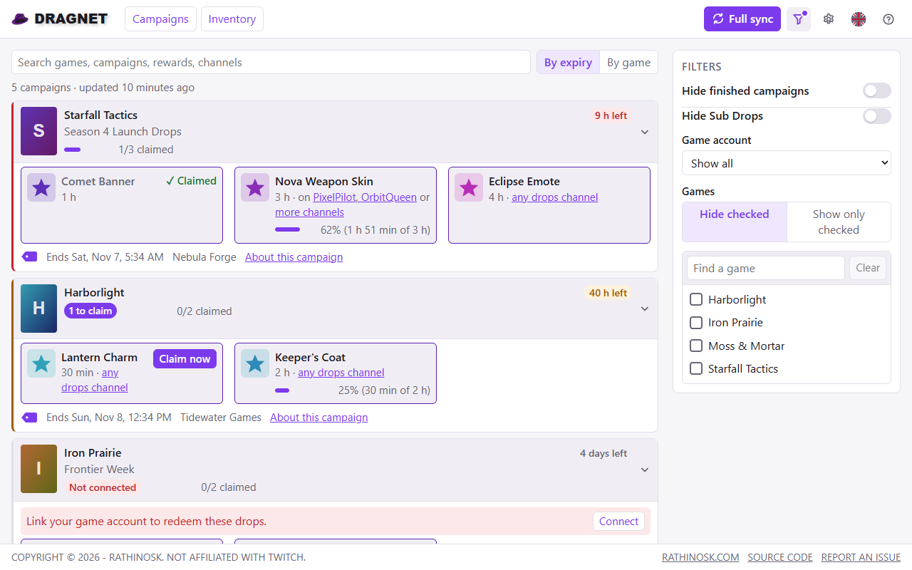
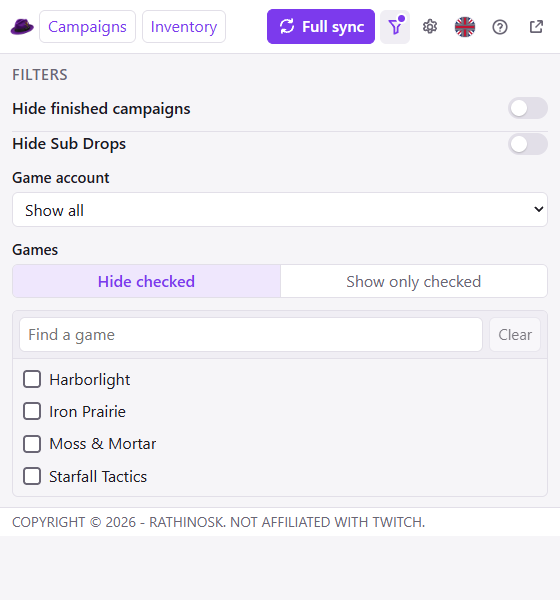
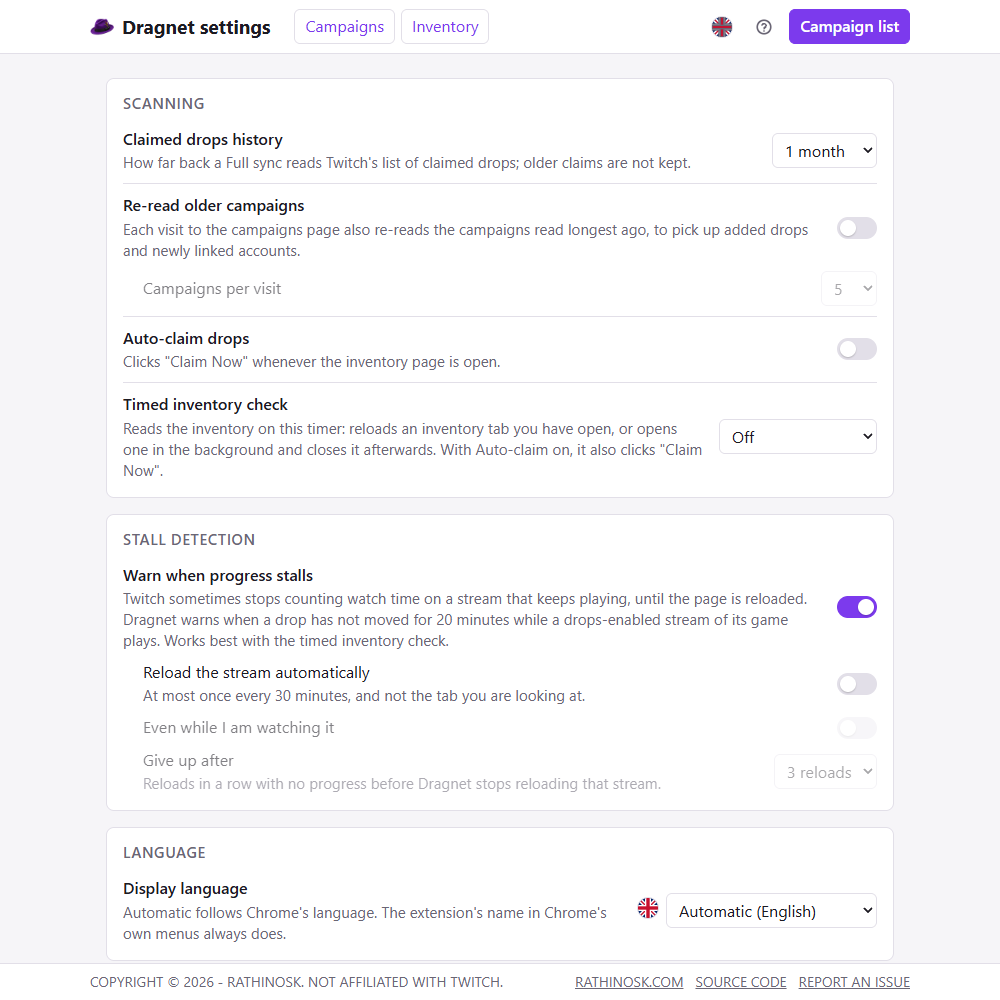

# Dragnet for Twitch


A Chrome extension that keeps track of the Twitch drop campaigns running now and your progress on each drop, sorted by when they end, so nothing expires unclaimed.

Dragnet reads Twitch's drops pages, [Campaigns](https://www.twitch.tv/drops/campaigns) and [Inventory](https://www.twitch.tv/drops/inventory), as they appear in your browser while you are logged in. It makes no network requests of its own.

Dragnet is not affiliated with, endorsed by or sponsored by Twitch Interactive, Inc. "for Twitch" only says what it works with. See [TRADEMARK.md](TRADEMARK.md).

<p>
  <picture>
    <source media="(prefers-color-scheme: dark)" srcset="docs/screenshots/popup-dark.png">
    
  </picture>
</p>

## Install

| Browser | Store |
| --- | --- |
| Chrome | [Chrome Web Store](https://chromewebstore.google.com/detail/cneaojpfakepepchkobghopfobgcponl) |
| Edge | Microsoft Edge Add-ons: link to follow |
| Firefox | Firefox Add-ons: link to follow |

## Usage

1. Log in to Twitch, with Twitch set to English.
2. Click **Full sync** in the popup. Dragnet opens the campaigns page in a new tab, reads every campaign, moves on to the inventory, reads your progress and claimed drops, and closes the tab. It takes a minute or two; leave the tab in front, since Chrome slows down background tabs.
3. From then on, just use Twitch. Every time you open the campaigns or inventory page, Dragnet reads what changed (new campaigns, progress, new claims) in a quick sweep. Run Full sync again whenever the list looks out of date.

The popup lists the campaigns running now, ending soonest first. Each card is one game, holding all of its current campaigns, and shows the time left until its next unclaimed drop ends (red under 24 hours, amber under 3 days; each drop shows its own), how many drops are claimed, a "Not connected" label when your game account is not linked (with a Connect link), and a "to claim" label when a drop is waiting to be claimed. Open a card for its drops: what each takes (watch time or subscriptions), which channels count, progress, and claim state. Search matches games, campaigns, publishers, drops, rewards and channels, and the list can be grouped by game.

The arrow button opens the same list in a full tab, with the filters beside it and a Statistics panel on top: active campaigns and games, drops in progress and ready to claim, campaigns ending within 24 hours and 7 days, and your claims over the last 7 and 30 days with a bar chart per day. Where a filter hides some campaigns the panel shows both numbers ("3 of 5"). Claims are counted from the claim history, which keeps only as many days as the history setting. The funnel shows the filters, the gear opens the settings page, the round flag opens the language setting, and the question mark opens the help page, which explains every label and setting. The About page (click the purple hat on the full page or the settings page) shows the version, licence, links and the changelog.

<p>
  <picture>
    <source media="(prefers-color-scheme: dark)" srcset="docs/screenshots/page-dark.png">
    
  </picture>
</p>

## Filters

Behind the funnel button in the popup, or beside the list in the full page (the funnel hides or shows the column). A dot on the funnel means the filters are open. Filters change only what is shown; Dragnet still reads and keeps everything, so changing one needs no new scan.

| Filter | What it does |
|---|---|
| Hide finished campaigns | Hides the campaigns you have finished. |
| Hide Sub Drops | Hides drops that need a subscription. A campaign with nothing else is hidden, and one whose only unclaimed drops need a subscription counts as finished. |
| Game account | Show all campaigns, hide those whose game account is not linked, or show only those (a to-do list of accounts to link). |
| Games | Hide the checked games, or show only them. With "Show only checked" and nothing checked, everything is shown. |

<p>
  <picture>
    <source media="(prefers-color-scheme: dark)" srcset="docs/screenshots/popup-filters-dark.png">
    
  </picture>
</p>

## Settings

On their own page, opened by the gear button.

| Setting | What it does |
|---|---|
| Claimed drops history | How far back a Full sync reads Twitch's claimed-drops list: 1, 2 or 3 weeks, or 1, 2 or 3 months (default 1 month). A normal visit stops sooner, at claims it already has. Older claims are not kept. |
| Re-read older campaigns | Each visit to the campaigns page also re-reads the 3, 5 or 10 campaigns read longest ago (at most every 15 minutes), so drops added to a running campaign and newly linked accounts show up without a Full sync. Off by default. |
| Auto-claim drops | Clicks Twitch's "Claim Now" on the inventory page before reading it, then reads the result. Claims only while an inventory page is open (an open one is watched for new buttons), or during a timed inventory check. Off by default. |
| Timed inventory check | Every 15 or 30 minutes, or 1, 2 or 4 hours: reloads an inventory tab you have open (not the one you are looking at), or opens one in the background and closes it after reading it. Reads progress, and with Auto-claim on clicks "Claim Now". Off by default. |
| Stall detection | Twitch sometimes stops counting watch time on a stream that keeps playing, until the page is reloaded. While a channel tab plays a drops-enabled stream, Dragnet compares each inventory read and, when none of that game's drops has moved for 20 minutes, shows "!" on its toolbar button and a line in the list with a **Reload stream** button. On by default. Options: reload the stalled tab automatically (at most every 30 minutes, not the tab you are looking at unless allowed), and give up after 1, 2, 3 or 5 reloads with no progress, which links to the game's drops-enabled streams. Dragnet never picks or switches channels. |
| Display language | Automatic (Chrome's language, the default) or one of Dragnet's languages. |

Below them, Last scans has a card for each Twitch page: when it was last read, how, and any warnings.

At the bottom, the Danger Zone holds the Twitch page data (read only) switch (off by default: Dragnet also reads the data Twitch's own drops pages load from Twitch's undocumented GraphQL endpoint, read only, for exact times and progress, the claim history without Load More, and drops or games the page reading misses; it still sends nothing to Twitch), the Diagnostics switch (off by default; it adds a button that opens a troubleshooting page, which probes and snapshots open Twitch drops tabs, and saves copies of Twitch markup Dragnet does not recognize) and buttons that delete Dragnet's local data, its synced data (settings and game filter), or both. Each delete asks first.

<p>
  <picture>
    <source media="(prefers-color-scheme: dark)" srcset="docs/screenshots/settings-dark.png">
    
  </picture>
</p>

If a scan stops because a Twitch page did not look as expected, a red banner says so and the stored list is kept as it was. The help page explains each message and what to do.

## Languages

Dragnet's own text follows Chrome's language unless another is picked on the settings page: English, French, German, Japanese, Portuguese (Brazil), Russian and Spanish (Spain and Latin America), the languages behind most of Twitch's viewing. In any other language it shows English.

These translations are machine-made and have not been reviewed by native speakers. Corrections are welcome, as an issue or a pull request against `dragnet-for-twitch/_locales/<language>/messages.json`.

Twitch itself still has to be set to English: Dragnet reads the text of Twitch's pages, and so far it can read only the English ones.

## Privacy

Dragnet has no server and makes no network requests. Everything it reads stays in your browser:

- What it reads from Twitch (campaigns, drops, progress, claimed history) is kept in Chrome's local extension storage, on this computer only. It is a copy of what the Twitch pages show and rebuilds itself from them.
- Your settings and game filter are kept in Chrome's sync storage, so Chrome carries them to your other computers if Chrome sync is on.
- It can read pages on `www.twitch.tv` only, and reads only the drops pages. With stall detection on (the default), it also notes which channel a channel tab shows, its game, whether it is drops-enabled, live and playing; that stays in session storage and is gone when the browser closes.
- With the timed inventory check on, it opens the inventory page in a background tab on your timer, as if you had opened it.
- Removing the extension deletes all of it, and the settings page's Danger Zone can delete it at any time.

Details are in [PRIVACY.md](PRIVACY.md).

## Development

No build step and no dependencies: the extension runs straight from source as ES modules.

```text
dragnet-for-twitch/   the extension: everything that ships, self-contained
  manifest.json       Manifest V3
  background.js       service worker: storage, merging, Full sync; no network calls
  scraper/            content scripts: page parsers, DOM hooks (selectors.js), page text (tokens.js),
                      and the optional Twitch page data hook (gql-hook.js) and collector (gql.js)
  core/               pure functions, no chrome.*: schema, merge, inventory, filters, view logic, statistics
  ui/                 popup, full page, settings, help and About pages; i18n.js
  _locales/           UI strings (Chrome's extension i18n)
  icons/
test/                 browser test harness, fixtures, saved snapshots (gitignored)
tools/                snapshot capture and scrub, local server, README screenshots
docs/screenshots/     images used here
```

**Tests.** Run `node tools/serve.js` from the repo root and open `http://localhost:8642/test/`. The page runs every test on load (PASS, FAIL or SKIP per case). Headless: `chrome --headless=new --virtual-time-budget=20000 --dump-dom http://localhost:8642/test/`. Saved page snapshots come from a logged-in account, so they are gitignored; on a fresh clone the cases that need them report SKIP and the committed fixtures still run. See [test/README.md](test/README.md) for the harness, the snapshot capture tool and notes on Twitch's page structure.

**Screenshots.** `node tools/screenshots.mjs` renders the images in `docs/screenshots/` from invented sample data. It needs Playwright, which is not a project dependency (`npm install --no-save playwright`, then `npx playwright install chromium`, or set `CHROME_PATH` to a Chromium build).

**Conventions.** Every DOM hook lives in `scraper/selectors.js`, with fallbacks and a self-check, so a Twitch layout change is a one-file fix. Scraped text is untrusted: values are coerced, only `https:` URLs are kept, and the UI is built with `textContent`, never `innerHTML`. Every UI string is in `_locales/en/messages.json`, the reference for the other locales; `test/i18n.test.js` checks that each locale has every message, the same `{placeholders}`, the plural forms its language needs (`_one`, `_few`, `_many`, `_other`), and Twitch's own button text ("Claim Now", "Load More") left in English. In the popup, a translation too long for the top bar turns the Full sync button into an icon. Source files start with the SPDX license header.

## License

Copyright (C) 2026 Rathinosk. Licensed under the GNU General Public License v3.0 or later: see [LICENSE](LICENSE).

The names "Dragnet for Twitch" and "Dragnet" are reserved and not covered by the license: forks and redistributions must use another name. See [TRADEMARK.md](TRADEMARK.md).
